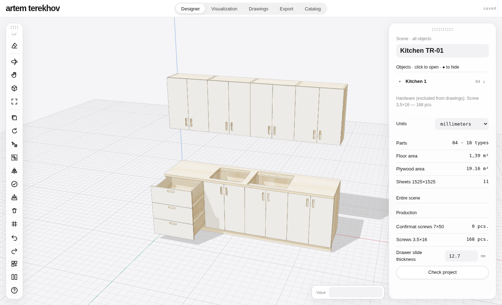
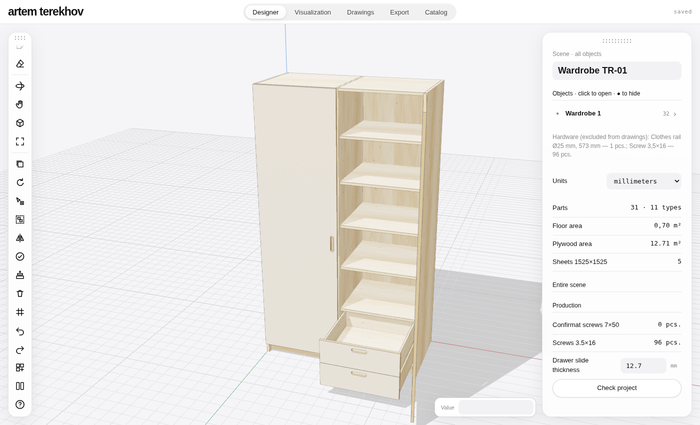
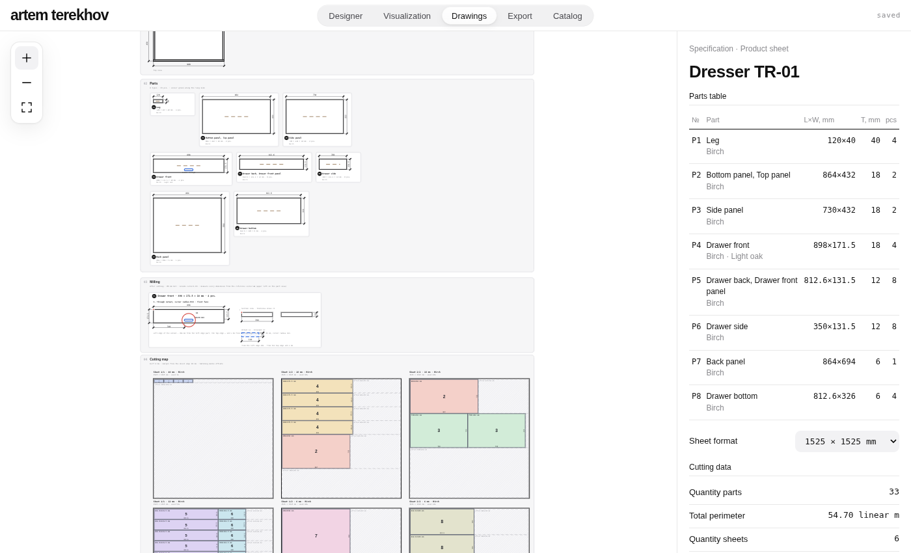

# Terekhov Bureau — plywood furniture designer

Design plywood furniture in the browser. Draw, cut, drill — get drawings and a cutting map.

→ **https://qwekurasa.github.io/terekhov-bureau/**



## Tools

- SketchUp-like 3D modelling — push/pull, move, rotate, tape, snaps
- Parametric furniture — wardrobe, kitchen, dresser, shelf, bedside, table
- Holes, slots, rounded cut-outs, dowel joints into the next board
- Hinges, slides, brackets — doors and drawers open with soft-close
- Photoreal render on your GPU
- Drawings, milling map, cutting map, PDF sheet
- Export: DXF, SVG, OBJ, DAE, CSV · import: DAE, OBJ, FBX, GLB, STL





## Run locally

```bash
git clone https://github.com/qwekurasa/terekhov-bureau && cd terekhov-bureau
python3 -m http.server 8080
```

One file, no build step.

## Support

- Solana: `64kwY5adPeQVfzvsyvEpke5wsJuVEPXAY3bm6VuFBZf`
- Ethereum: `0xad4a06e063d0e83e783f9fb17efc6524a83a40f2`
- USDT TRC20: `TERWLLYABDAvMQTKPkpXwdKpU4AS5k8ff3`

## License

All rights reserved. Third-party: three.js, three-mesh-bvh, three-gpu-pathtracer, three-bvh-csg (MIT).
